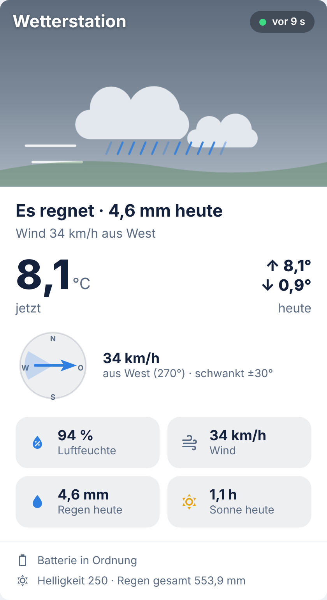
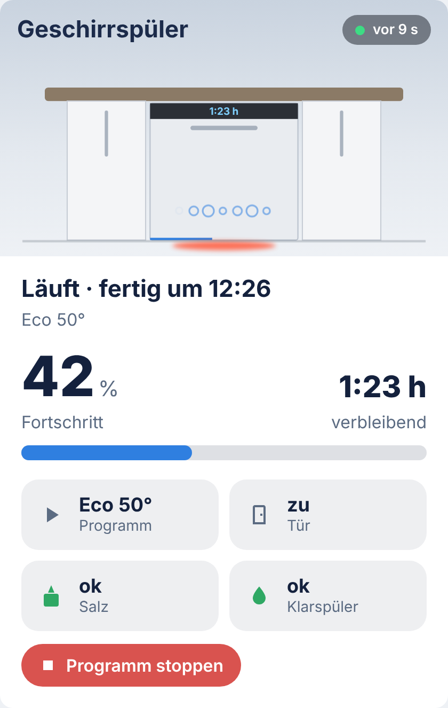
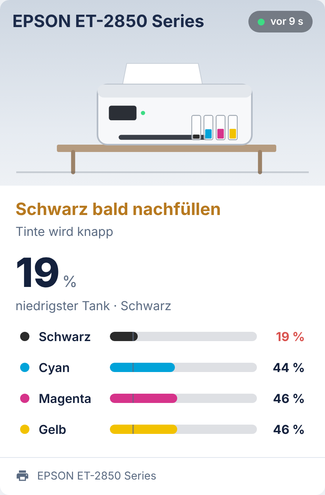

# ha-cards – Dashboard-Karten für Home Assistant

Karten im Stil der Growatt-SPH-Karte aus
[growatt-modbus-ha](https://github.com/dreyer-thomas/growatt-modbus-ha). Beide finden ihre
Entitäten selbst – die minimale Konfiguration ist nur der Kartentyp.

| Wetterstation | Regen & Wind | Nacht | DiskStation | Warnung |
|---|---|---|---|---|
|  |  |  |  |  |

## Installation

Marketplace (HACS): **Einstellungen → Marketplace → Aus Link hinzufügen** →
`https://github.com/dreyer-thomas/ha-cards`, Kategorie **Dashboard**, herunterladen, Seite neu laden.

Manuell: `dist/ha-cards.js` nach `/config/www/` kopieren und unter
Einstellungen → Dashboards → ⋮ → Ressourcen als JavaScript-Modul `/local/ha-cards.js` eintragen.

## Wetterstation

```yaml
type: custom:hc-weather-station-card
title: Wetterstation   # optional
```

- Himmel nach Messwerten: Sonne (Sonnenscheindauer zählt gerade hoch), bewölkt, Regen
  (Regensensor), Nacht (`sun.sun`), Wind ab 20 km/h mit Böen-Animation
- Temperatur mit Tageshoch und -tief, Windrose mit Richtung und Schwankungsbereich
- Kacheln: Luftfeuchte, Wind, Regen heute, Sonne heute – ein Klick öffnet den Verlauf
- Warnung bei schwacher Batterie

Gefunden wird automatisch eine Homematic-Station (HM-WDS100 u. ä., Integration
„Homematic(IP) Local“). Andere Stationen per Zuordnung:

```yaml
type: custom:hc-weather-station-card
entities:
  temperature: sensor.aussen_temperatur
  humidity: sensor.aussen_feuchte
  wind_speed: sensor.wind
  wind_direction: sensor.windrichtung      # Grad, 0 = Nord
  rain_total: sensor.regenzaehler          # fortlaufender Zähler in mm
  raining: binary_sensor.regen
  sunshine: sensor.sonnenscheindauer       # fortlaufender Zähler in min
```

„Regen heute“, „Sonne heute“ und Hoch/Tief kommen aus der Langzeitstatistik von Home Assistant.

## DiskStation

```yaml
type: custom:hc-diskstation-card
title: DiskStation   # optional, sonst Gerätename
```

- NAS-Grafik mit einer Status-LED pro Laufwerksschacht, Netzwerkverkehr als Fluss
- Statuszeile nach Wichtigkeit: defekte Platte → Volume-Problem → DSM-Update → Sicherheitsberater
- Belegung des Volumes mit freiem Platz, CPU, Arbeitsspeicher, Upload, Download
- Liste der Platten mit Status und Temperatur (Klick öffnet den Temperaturverlauf)

Benötigt die Integration **Synology DSM**. Bei mehreren DiskStations `device_id:` angeben.

## Geschirrspüler

```yaml
type: custom:hc-dishwasher-card
```

| Läuft | Bereit |
|---|---|
|  |  |

- Küchenzeile mit Gerät: Restzeit im Display, Fortschrittsleiste, „infoLight“ auf dem Boden während des Programms,
  offene Tür mit Korb, Funkeln wenn fertig
- Statuszeile: „Läuft · fertig um 12:25“, „Startvorwahl“, „Fertig – bitte ausräumen“, Störung
- Fortschritt und Restzeit, Kacheln für Programm, Tür, Salz und Klarspüler, Hinweise bei Nachfüllbedarf
- **Programm starten** (gewähltes Programm, nur wenn Fernstart aktiv ist) und **Programm stoppen** – jeweils mit Rückfrage

Benötigt die Integration **Home Connect**.

## Ladestation

```yaml
type: custom:hc-wallbox-card
```

| Lädt | Frei |
|---|---|
|  |  |

- Wallbox mit Statusring, Ladekabel und Auto, Energiefluss beim Laden
- Zeigt das Foto des eigenen Autos, wenn die Integration **BavarianData** ein Fahrzeugbild liefert (wird automatisch erkannt). Sonst eine Zeichnung.

```yaml
type: custom:hc-wallbox-card
car_image: image.mein_auto   # eigenes Bild: image-Entität, Entität mit Bild oder URL; "none" = Zeichnung
```
- Leistung, Energie des Ladevorgangs, Ströme je Phase (L1–L3)
- kWh heute, im laufenden Monat (aus der Langzeitstatistik) und gesamt, Griff-Temperatur

Benötigt die Integration **Tesla Wall Connector**.

## Drucker

```yaml
type: custom:hc-printer-card
```



- Drucker mit Tintentanks im Bild, Papier läuft beim Drucken heraus
- Füllstand je Farbe mit Warnschwelle des Druckers, Warnung „… bald nachfüllen“

Benötigt die Integration **Internet Printing Protocol (IPP)**.

## Entwicklung

`tools/preview.html` zeigt die Karten mit Beispieldaten im Browser
(`?card=weather`, `nas`, `dw`, `wb` oder `pr`).(`?card=weather` bzw. `?card=nas`).

Gestaltung angelehnt an die Karten von [BavarianData](https://github.com/JustChr/BavarianData) (MIT).

## Haftung

MIT-Lizenz, Nutzung auf eigene Verantwortung.
